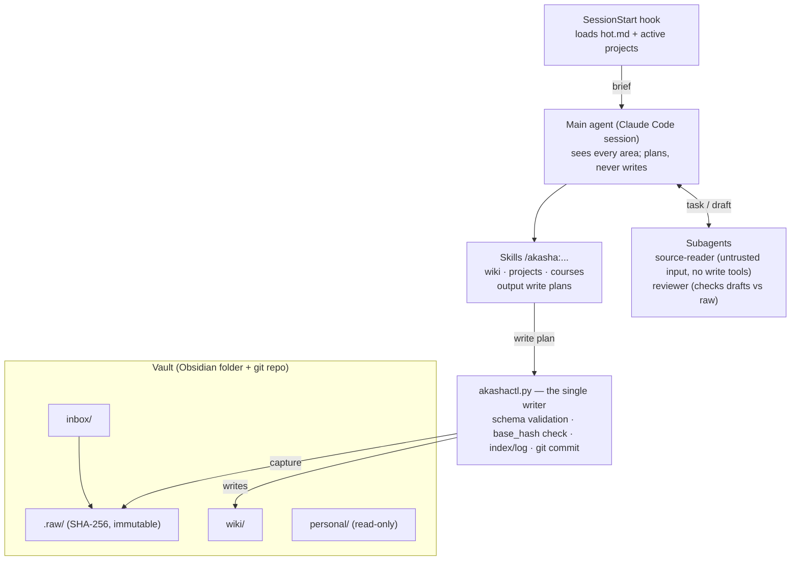

# Akasha: design

*Source of truth for design decisions until the code exists. Last updated 2026-11-25 (ADR-0004).*

## Overview

Akasha is a Claude Code plugin that turns an Obsidian vault into a personal assistant: one agent that keeps a linked wiki of everything I capture, tracks what I'm working on, and turns school notes into study material. It follows the inbox → raw → wiki pattern from [claude-obsidian](https://github.com/AgriciDaniel/claude-obsidian), rebuilt smaller so I own and understand every part.

**The problem.** Useful material (reels, videos, articles, lecture notes) gets saved and never revisited, and project context lives in my head. Saving is one tap; retrieving is real effort, so retrieval never happens.

**Design principles**

- **One agent, many skills.** A single main agent sees the whole vault. Areas of life (wiki, projects, courses) are skills and data schemas, not separate agents, so cross-area questions work without handoffs.
- **The data outlives the agent.** Everything is plain Markdown in a git repo. The vault, schemas and writer are the durable product; the agent on top is replaceable.
- **Raw is sacred.** Every source is kept as an immutable, hash-named copy. Every generated claim links back to it.
- **One writer.** Only `akashactl.py` writes to the vault. Skills and agents propose plans; the writer validates, writes and commits.
- **My writing is untouchable.** `personal/` is read-only to the system.
- **Start with one daily loop.** Each area is added only after the previous one is in daily use.

## What it does

| Capability | What I do | What I get |
| --- | --- | --- |
| Knowledge wiki | Drop a file or link into `inbox/` (or send it from my phone later) | A source page, linked concept and entity pages, citations back to the raw copy |
| Ask the vault | Ask a question in Claude Code | An answer citing vault pages, with gaps and weak evidence flagged; nothing changes unless I save it |
| Project tracker | Log progress in one line | Updated project page, next action, regenerated `now.md` dashboard |
| Course summaries | Point it at a course code | Summary, shared concept pages and active-recall questions, built from my lecture notes without touching them |
| Session brief | Start Claude Code in the vault | Recent context plus active projects and their next actions, already loaded |

Later versions add scheduled jobs (morning brief and weekly digest via headless `claude -p`), phone capture through a Telegram bot for Instagram, YouTube and web links, and new areas through the extension contract below.

## Architecture

One main agent reasons across every area; only `akashactl.py` touches the vault.



Subagents exist for task shape, not for areas: `source-reader` isolates untrusted content, and `reviewer` checks drafts with fresh context. See [ADR-0002](decisions/0002-one-agent-skills-per-area.md).

## Plugin structure

```
akasha/
  .claude-plugin/
    plugin.json          name, version, description
    marketplace.json     added in Phase 6 for one-command install
  skills/
    setup/SKILL.md       create or adopt a vault, write akasha.json
    capture/SKILL.md     inbox -> .raw
    ingest/SKILL.md      .raw -> wiki pages
    ask/SKILL.md         read-only answers with citations
    save/SKILL.md        keep an answer as a question page
    lint/SKILL.md        vault health report
    project/SKILL.md     create, update, pause, close projects
    course/SKILL.md      school notes -> study pages
    brief/SKILL.md       on-demand version of the session brief
  agents/
    source-reader.md     reads one untrusted source, returns a draft
    reviewer.md          checks drafts and summaries against raw sources
  hooks/
    hooks.json           SessionStart -> akashactl brief
  bin/
    akashactl            wrapper on the Bash PATH: python3 -I scripts/akashactl.py
  scripts/
    akashactl.py          the only process that writes to the vault
    lib/                 frontmatter (strict YAML subset), schema, hashing, index, git helpers
  schema/
    note-types.toml      every note type, its folder, required fields (read with tomllib)
  templates/             one Markdown template per note type
  tests/                 pytest suite run against a fixture vault
```

| Component | Role |
| --- | --- |
| Skills | Instructions Claude loads when relevant; each also runs as `/akasha:<name>`. They gather context and produce a write plan, never write files. |
| Agents | Subagents with isolated context and restricted tools, used only for untrusted input and independent review. |
| Hook | Runs `akashactl brief` at session start so Claude begins with recent context and active projects. |
| `akashactl.py` | Python CLI: `capture`, `apply`, `lint`, `brief`, `undo`, plus read-only `validate`. Validates plans, writes, updates index and log, commits. Needs Python 3.11+ and fails with a clear message otherwise (macOS ships 3.9; use Homebrew's). Called as `akashactl` through `bin/`, run with `python3 -I` so modules in the vault folder can't shadow its imports. |
| Schema | Single source of truth for note types. Adding an area starts here. |

Every auto-invocable skill costs context on every turn, so descriptions stay to one line and rarely used skills (`setup`, `lint`) are user-invoked only.

## Vault structure

```
vault/
  inbox/                  drop zone; files stay until I remove them
  .raw/
    <sha256>.<ext>        immutable, create-only source copies
    manifest.json         original name, type, captured date, origin URL
  personal/               my own notes, read-only to Akasha
  wiki/
    index.md              catalog of canonical pages
    log.md                one entry per operation, newest first
    hot.md                short summary of recent context
    sources/              one page per ingested source
    concepts/             ideas and techniques, shared across all areas
    entities/             people, tools, organizations
    questions/            saved answers
    courses/<code>/       summary.md, review.md per course
    projects/<slug>.md    one page per project
    now.md                generated dashboard of active work
  akasha.json              vault identity and settings
  .akasha/                 gitignored runtime state: locks, search index
```

| Type | Folder | Extra required fields | Statuses |
| --- | --- | --- | --- |
| `source` | `wiki/sources/` | `raw` (hash), `origin`, `kind` | `ingested` |
| `concept` | `wiki/concepts/` | `sources` | `seed`, `developing`, `evergreen`, `contested` |
| `entity` | `wiki/entities/` | `sources` | `seed`, `developing`, `evergreen` |
| `question` | `wiki/questions/` | `asked` | `answered`, `open` |
| `course` | `wiki/courses/<code>/` | `course`, `built_from` | `current`, `stale` |
| `project` | `wiki/projects/` | `next_action`, `last_touched` | `active`, `paused`, `done` |

Common frontmatter on every generated page: `type`, `title`, `status`, `created`, `updated`, `tags`, `generated: true`. Dates are `YYYY-MM-DD`.

Frontmatter is read and written by a stdlib parser for a strict YAML subset: a flat mapping of strings, integers, booleans, null and lists of those. Anything richer is refused, not guessed, so hand-written notes with complex YAML are left alone. See [ADR-0004](decisions/0004-toml-schema-stdlib-frontmatter.md).

## Core mechanics

Every change follows one path: a skill drafts a plan, `akashactl apply` validates and writes it, git records it as one commit.

**Capture.** `akashactl capture` hashes each file in `inbox/` (recursively) with SHA-256; if `.raw/<hash>.<ext>` is new it copies the file create-only and adds a manifest entry, otherwise it skips the duplicate. Hidden files, symlinks and empty files are skipped. The inbox copy is never deleted by Akasha. A link file (`.url`, `.webloc`, or a small text file holding one URL) is stored like any other file, with `kind: link`, `origin: <url>` and `fetch: pending` until a fetcher (Phase 7) turns it into text. `.raw/manifest.json` is the one file in `.raw/` that changes; it is rewritten atomically. Each run that adds something is one commit; `--dry-run` writes nothing.

**Vault marker and commits.** `akashactl` only writes to a folder that has `akasha.json` (`{"version": 1, "personal": [...]}`) and is the root of a git repository. Every write is one commit authored as `Akasha <akasha@localhost>`, with an `Akasha-Operation: <name>` trailer that `undo` uses to find Akasha commits. Only the paths the operation wrote are committed, so anything I have staged stays staged. Vault git hooks are skipped (`--no-verify`).

**Ingest.**

1. `/akasha:ingest` lists raw files with no source page yet.
2. `source-reader` reads each and returns a draft: summary, key points with short verbatim quotes, candidate concepts and entities.
3. The main agent merges new material into existing concept and entity pages and builds one write plan.
4. `akashactl apply --dry-run` shows pages created, pages changed, index and log entries.
5. I approve; `akashactl apply` writes, commits and refreshes `hot.md`.

**Ask and save.** `/akasha:ask` is read-only, cites pages, and flags thin or contested evidence. `/akasha:save` turns a kept answer into a `question` page through the same plan path.

**Write contract.** A plan is JSON. `akashactl` rejects plans that write outside `wiki/`, touch `personal/` or `.raw/`, fail the schema, or link to pages that won't exist.

```json
{
  "operation": "ingest",
  "pages": [
    {"action": "create", "path": "wiki/sources/spaced-repetition-video.md", "content": "..."},
    {"action": "update", "path": "wiki/concepts/spaced-repetition.md", "base_hash": "9f2c...", "content": "..."}
  ],
  "log": "Ingested 1 source; created 1 page, updated 1"
}
```

**Protection and undo.** Each `update` carries the `base_hash` of the page as read; if I edited it since, `apply` stops. Each apply is one commit, so `akashactl undo` is a `git revert` of the last Akasha commit. See [ADR-0003](decisions/0003-own-core-git-undo.md).

**Security boundary.** Captured content may contain prompt injection. Untrusted content is read only by `source-reader` (no write, shell or web tools); `akashactl` accepts only well-formed plans into allowed folders; every write is a dry run first and a commit after.

## Feature modules

Each feature = a skill + a note type + optionally a hook or scheduled job, all writing through `akashactl`.

**Projects.** One page per project in `wiki/projects/<slug>.md` with `status`, `next_action`, `last_touched`, a dated log and links. `/akasha:project update <slug> "<what I did>"` appends to the log, moves the next action, and regenerates `now.md` (active projects by last touched, 14-day stale flag).

**Course summaries.** `/akasha:course <code>` reads that course's notes in `personal/` plus captured course files, and writes `summary.md`, shared concept pages, and `review.md` with active-recall questions in collapsed callouts. `built_from` records source files and dates so reruns are incremental and lint can flag stale summaries.

**Session brief.** The SessionStart hook runs `akashactl brief`, printing `hot.md` and active projects with next actions into the session's context. `/akasha:brief` shows the same on demand.

**Extension contract.** A new area = (1) note type in `schema/note-types.toml`, (2) template, (3) `skills/<area>/SKILL.md` producing write plans, (4) optionally a brief line or scheduled job. No changes to existing code.

## How to use it

Runs in Claude Code on my Mac from the vault folder. Cloud sessions do not load local plugins.

```bash
cd ~/vault
claude --plugin-dir ~/code/akasha
```

From Phase 6, install from GitHub:

```bash
claude plugin marketplace add SC1432/akasha
claude plugin install akasha@<marketplace-name>
```

Then `/akasha:setup` once.

| Command | Writes? | Does |
| --- | --- | --- |
| `/akasha:setup` | Yes, after preview | Create or adopt a vault |
| `/akasha:capture` | `.raw/` only | Hash and store inbox files |
| `/akasha:ingest` | Yes, after dry run | Turn raw sources into wiki pages |
| `/akasha:ask` | No | Answer from the vault with citations |
| `/akasha:save` | Yes, after dry run | Keep an answer as a question page |
| `/akasha:project` | Yes | `new`, `update`, `pause`, `close`, `list` |
| `/akasha:course` | Yes, after dry run | Build or refresh a course summary and review |
| `/akasha:brief` | No | Show recent context and active work |
| `/akasha:lint` | No | Report dead links, orphans, bad frontmatter, stale summaries |
| `akashactl undo` | Yes | Revert the last Akasha commit |

## Risks, open decisions and non-goals

| Risk | Mitigation |
| --- | --- |
| Scope creep | Usage gates; no new area until the last is used for two weeks |
| Wrong or overconfident summaries | Verbatim quote per key point, raw link, `reviewer` spot-checks |
| Prompt injection from captures | Read-only `source-reader`, schema-checked plans, dry runs, git history |
| Overwriting my edits | `base_hash` check; `personal/` never writable |
| Inbox outgrows ingest | Weekly digest and lint report inbox count |
| Context cost of many skills | One-line descriptions; rare skills user-invoked only |
| Instagram blocks the fetcher | Screenshot fallback; throwaway account cookies |

Open decisions: adopt existing vault or start fresh; which folders are `personal/`; always-on host for Phase 7; sync method; API key vs Claude Code plan for headless jobs.

Non-goals for v1: standalone always-on app, embeddings search, multi-user sharing, writes without a dry run.
