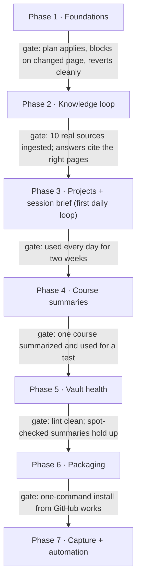

# Roadmap

Seven phases. Each ends in a gate that must pass before the next starts. Gates measure use, not code written. Estimates assume evenings and weekends around classes.

**Current phase: 1 (in progress).**

## Phase 1 · Foundations (estimate: 1–2 weekends)

- [x] Create the repo
- [x] Settle schema and frontmatter formats without third-party packages ([ADR-0004](decisions/0004-toml-schema-stdlib-frontmatter.md)): `schema/note-types.toml`, `scripts/lib/frontmatter.py`, `scripts/lib/schema.py`, tests
- [x] Scaffold `.claude-plugin/plugin.json`, `skills/`, `scripts/`, `schema/`, `tests/` (plus `bin/akashactl` and read-only `akashactl validate`)
- [ ] Fixture vault in `tests/` with sample inbox files and a `personal/` note
- [ ] `akashactl capture`: SHA-256 hash, create-only copy to `.raw/`, manifest entry, duplicate skip
- [ ] `akashactl apply`: parse plan, allow-list paths, validate frontmatter against `note-types.toml`, check `base_hash`, update `index.md` and `log.md`, commit
- [ ] `akashactl apply --dry-run` and `akashactl undo`
- [ ] `/akasha:setup`: preview, adopt existing vault, pick `personal/` folders, write `akasha.json`, `git init`
- [ ] pytest: writes outside `wiki/` refused, `personal/` untouched, changed page blocks apply, undo restores
- [ ] Load with `claude --plugin-dir` and run setup on a copy of the real vault

## Phase 2 · Knowledge loop (estimate: 1–2 weeks)

- [ ] `source-reader` agent: read-only tools, returns a draft with key points and verbatim quotes
- [ ] Templates for `source`, `concept`, `entity`
- [ ] `/akasha:ingest`: list unprocessed raw files, merge into existing concept pages, build plan, dry run, apply
- [ ] `hot.md` refresh after every apply
- [ ] `/akasha:ask`: keyword search over `wiki/`, answer with page links, flag thin or contested evidence
- [ ] `/akasha:save`
- [ ] Ingest 10 real sources (articles, PDFs, pasted reel captions) and check the answers

## Phase 3 · Projects and session brief (estimate: 1 week)

- [ ] `project` note type and template
- [ ] `/akasha:project` with `new`, `update`, `pause`, `close`, `list`
- [ ] `now.md` generation: active projects by last touched, 14-day stale flag
- [ ] `akashactl brief` and the SessionStart entry in `hooks/hooks.json`
- [ ] Create pages for current projects, including one for Akasha itself
- [ ] Two weeks of daily use; log friction on the Akasha project page

## Phase 4 · Course summaries (estimate: 1 week)

- [ ] `course` note type with `built_from` tracking
- [ ] `/akasha:course`: read a course's notes in `personal/`, write `summary.md` and `review.md`, link concept pages
- [ ] Incremental refresh that rebuilds only topics whose notes changed
- [ ] Stale detection when notes are newer than the summary
- [ ] Use it to prepare for one test

## Phase 5 · Vault health (estimate: 1 week)

- [ ] `akashactl lint`: dead links, orphans, missing frontmatter, empty sections, stale summaries, inbox count
- [ ] `reviewer` agent: compare a sample of summaries against their raw sources
- [ ] `/akasha:lint` report, with fixes proposed as normal plans
- [ ] Run on the real vault and clear the findings

## Phase 6 · Packaging (estimate: 1 weekend)

- [ ] `.claude-plugin/marketplace.json`, README with install and command reference, version tag, `LICENSE` (the plugin directory requires one)
- [ ] One-line skill descriptions; `setup` and `lint` user-invoked only
- [ ] Install from GitHub on a second machine or a fresh user account

## Phase 7 · Capture and automation (estimate: 2–3 weeks)

- [ ] Decide host and vault sync
- [ ] Telegram bot that writes links, text and screenshots into `inbox/`
- [ ] Fetchers: YouTube captions (yt-dlp), web pages (trafilatura), Instagram (yt-dlp or instaloader + Whisper) with screenshot fallback
- [ ] Scheduled `claude -p` jobs through launchd: morning brief and weekly digest
- [ ] Done when a reel sent from my phone becomes a wiki page after the next ingest
